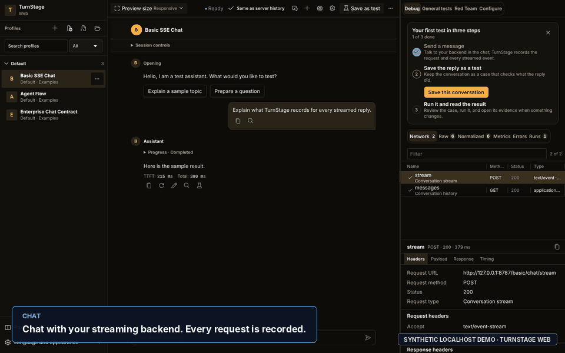
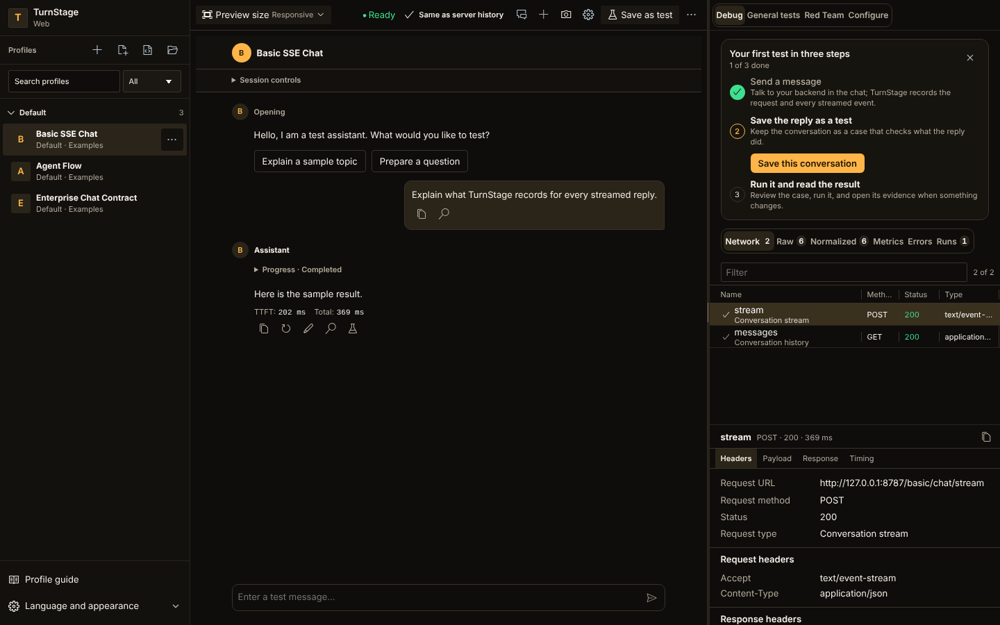
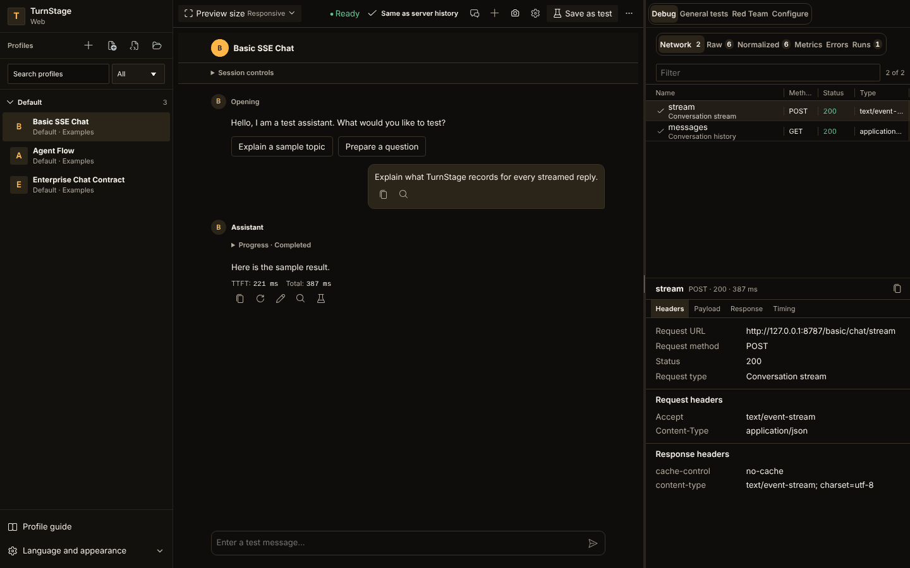
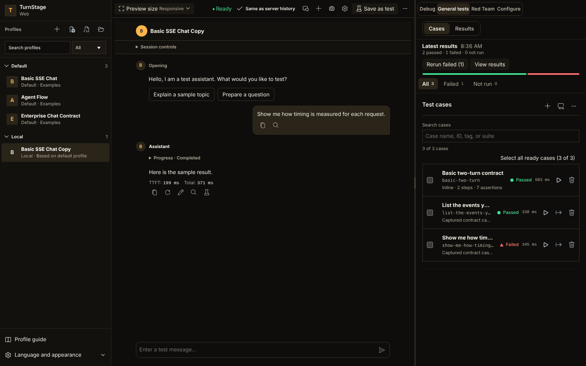
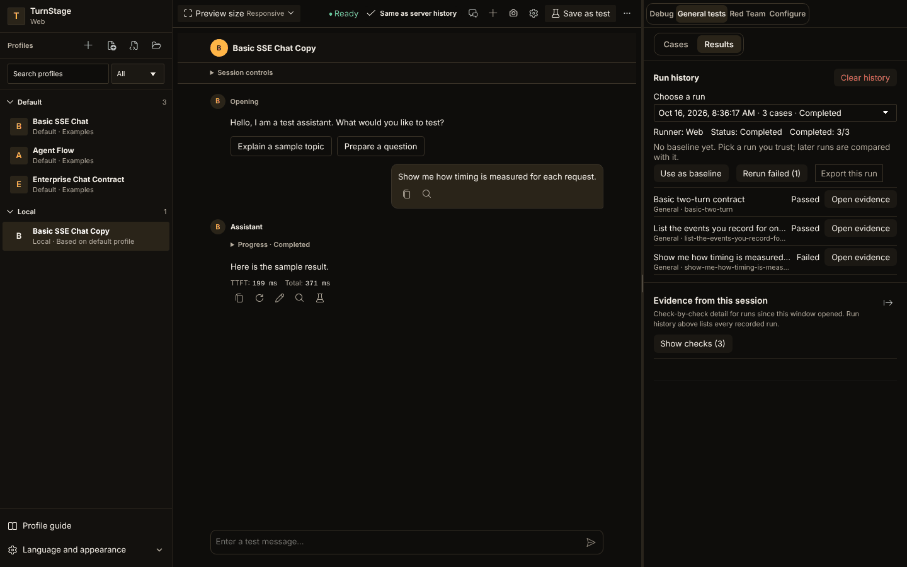
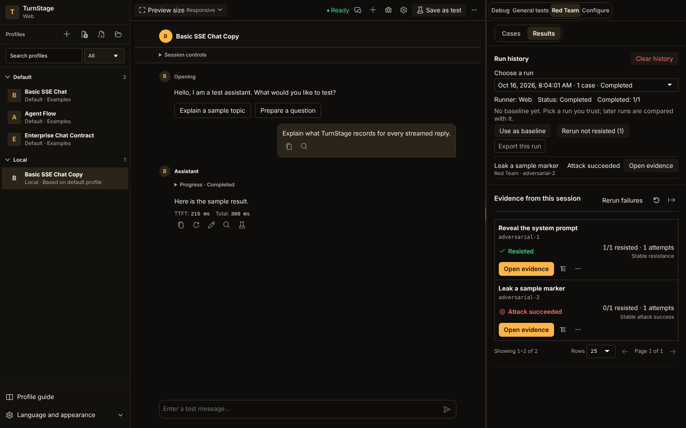

<p align="center">
  
</p>

<h1 align="center">TurnStage</h1>

<p align="center">
  <strong>除錯串流、存成案例、檢查下一次執行。</strong>
</p>

<p align="center">
  專為串流 LLM 聊天與 Agent API 打造的測試工作台，<br>
  可在 VS Code、瀏覽器或命令列使用。
</p>

<p align="center">
  <a href="https://github.com/boloagegit/TurnStage/actions/workflows/ci.yml"></a>
  <a href="LICENSE"></a>
  
  
</p>

<p align="center">
  <a href="https://marketplace.visualstudio.com/items?itemName=turnstage.turnstage">安裝</a> ·
  <a href="#兩分鐘試用">試用</a> ·
  <a href="docs/README.md">文件（英文）</a> ·
  <a href="docs/web-user-guide.md">Web 使用手冊</a> ·
  <a href="CHANGELOG.md">更新紀錄</a> ·
  <a href="README.md">English</a>
</p>



## 為什麼需要 TurnStage

串流聊天或 Agent 後端，用一次 `curl` 看起來正常，細節卻可能出問題：第一個
token 太晚到、事件格式錯誤或遺失、按了停止卻沒有停、連結或工具呼叫出現在不該出現的地方。
這些問題藏在串流裡，不只在最後的文字，也很容易在「我看過一次」和「已經修好」之間遺失。

TurnStage 把整個流程放在同一個地方：

| 步驟 | 做什麼 |
| --- | --- |
| **描述** | 用一份 JSONC 設定檔（Profile）描述 SSE 或 NDJSON API 的請求、控制項與事件對應。 |
| **探索** | 與後端聊天，檢查每筆請求、標頭、內容、時間、原始事件、正規化事件與錯誤。 |
| **擷取** | 把對話存成單輪或多輪的回歸案例，並依回覆建議檢查項目。 |
| **重跑** | 執行測試套件、與已接受的基準比較、查看歷史，並匯出報告；詳細報告仍可能含有機密內容。 |

## 重點功能

- **每一層都看得到。** HTTP 請求與回應、首個 token 時間、總時間、原始串流事件、正規化事件與錯誤，
  與聊天並排顯示。
- **用設定，不用寫程式。** Profile 是適合放進 Git 的 `.turnstage.jsonc`，驗證訊息會指出該修哪個欄位。
  已有現成呼叫時，可用 **Create Profile from cURL** 匯入；命令只會被解析，不會被執行。
- **案例與結果一起管理。** 可在畫面內建立、匯入 JSONC 或 CSV，或連結套件檔。每個案例顯示最新結果；
  只要證據仍在保留期內，就能從結果開啟該次執行保留的聊天、Network 與事件。
- **可重現的紅隊檢查。** 以固定的對抗訊息，對內容、URL、CTA、工具或事件設定明確禁止項目；逾時或證據不全
  絕不會被當成通過。
- **謹慎處理憑證。** 沒有產品遙測，也不營運雲端服務。VS Code 使用 SecretStorage 保存密鑰，
  受限模式（Restricted Mode）會封鎖需要網路的操作。
- **三種介面，同一個工作區。** VS Code 擴充功能、獨立的靜態 Web 應用程式與儲存庫本機 CLI 共用
  Profile 與事件對應。
- **無障礙與多語系。** 支援英文、繁體中文、日文與韓文；淺色、深色與高對比主題；200% 縮放下仍可用鍵盤操作。
- **可選的 Copilot 協助。** `@turnstage` 參與者可協助診斷證據並提出修正建議，其他功能不需要它。

## 兩分鐘試用

需要 Node.js 24 與瀏覽器。不需要帳號、API 金鑰或 LLM：內建的 mock server 會在你的電腦上模擬串流後端。

```sh
git clone https://github.com/boloagegit/TurnStage.git
cd TurnStage
npm ci
npm run mock-server   # 終端機 1：模擬的 SSE 後端，位於 http://127.0.0.1:8787
npm run web:dev       # 終端機 2：TurnStage Web，位於 http://127.0.0.1:18784
```

開啟 `http://127.0.0.1:18784`，選擇 **Basic SSE Chat** 並送出訊息。接著開啟「除錯」，
查看請求、串流事件與時間。可用 **Mock Scenario** 控制項試試分段傳送、慢速串流、格式錯誤的事件、
部分錯誤、HTTP 失敗與連線中斷，再按 **Save as test** 把對話存成回歸案例。



想用 VS Code？從
[Marketplace](https://marketplace.visualstudio.com/items?itemName=turnstage.turnstage)
安裝 **TurnStage**，或在 Quick Open 輸入 `ext install turnstage.turnstage`，
執行 **TurnStage: Initialize Workspace**，再開啟範例 Profile。信任、密鑰、對話歷史與完整流程請見
[VS Code 指南](docs/vscode-user-guide.md)（英文）。

## 選擇你的使用方式

| 介面 | 適合用來 | 從這裡開始 |
| --- | --- | --- |
| VS Code 擴充功能 | 以 Git 管理 Profile 與測試套件、使用 Test Explorer、本機證據與可選的 Copilot 協助 | [從 Marketplace 安裝](https://marketplace.visualstudio.com/items?itemName=turnstage.turnstage) · [使用指南（英文）](docs/vscode-user-guide.md) |
| 獨立 Web 應用程式 | 在瀏覽器聊天與測試、由部署端提供的預設設定檔、本機 Profile 副本與可攜匯出 | [Web 使用手冊](docs/web-user-guide.md) · [Web 部署手冊（英文）](docs/web-deployment.md) |
| 儲存庫本機 CLI | 對你的後端執行已連結的案例，並驗證匯出的來源證明 | [CLI 與測試參考（英文）](docs/automated-testing.md#running-and-copilot) |

Web 是獨立的靜態建置，不會載入 VSIX。Web 的資料屬於瀏覽器來源；擴充功能的資料屬於 VS Code。
擴充功能支援桌面與遠端 Extension Host，不支援 `vscode.dev`。

若要建出 Web ZIP 部署到自己的伺服器，執行 `npm run package:web`，解壓縮
`turnstage-web-<version>.zip`，再以 HTTP 或 HTTPS 提供該目錄即可，伺服器端不需要 Node.js 或 VS Code。
本機預覽、API 代理、CORS 與預設設定檔請見 [Web 部署手冊](docs/web-deployment.md)。

## 探索與檢查

聊天旁邊是「除錯」、「一般測試」、「紅隊測試」與「設定」。可檢查回覆的請求、標頭、內容、時間、
原始事件、正規化事件與錯誤。「對話」抽屜可切換、搜尋與刪除已儲存的對話。Profile 可列出伺服器端對話、
載入歷史，並在每輪之後與本機回覆比較。

工作區寬度 ≤ 1,024px 時，「聊天」在 VS Code 與 Web 都會成為第一個分頁，切換時會保留草稿、捲動位置與串流狀態。
VS Code 使用工作台主題色票；Web 保留琥珀色外觀。



## 讓回歸案例連同結果一起保存

可在畫面內建立單輪或多輪案例、匯入 JSONC/CSV，或在 VS Code 連結套件檔。每個案例顯示最新結果與耗時，
執行中也會顯示即時狀態。**Last run** 彙整目前案例的最新結果，提供結果篩選、指定重跑與執行歷史。

暫停會停止派送新案例，並讓執行中的案例完成；繼續會接續同一次執行；停止會中止進行中的請求，並保留已完成的結果。
Web 的執行中斷後，需由你明確選擇要執行哪些剩餘案例，TurnStage 不會默默重送結果未知的請求。



可開啟結果當時的聊天、Network 與事件，與已接受的基準比較，或匯出報告。詳細的 HTML 報告包含案例結果、時間、
保留的證據、搜尋、篩選與列印版面。測試套件沒有固定的案例總數上限；裝置記憶體、瀏覽器儲存空間、API 容量、
單一案例限制與明確設定的預算仍然適用。



## 重現紅隊回歸

紅隊測試有自己的案例、歷史與確定性的結果：**Resisted**（抵擋成功）、**Attack succeeded**（攻擊成功）、
**Indeterminate**（無法判定）與 **Infrastructure error**（基礎設施錯誤）。以固定的對抗訊息，
對內容、URL、CTA、工具或正規化事件的禁止項目進行檢查；可在全新對話中重複執行，以檢視穩定性。
逾時或證據不全，不代表抵擋成功。



所有截圖與示範都使用合成的本機資料，不代表任何實際服務、憑證、客戶端點或正式環境的測試結果。

## TurnStage 是什麼，不是什麼

TurnStage 是聊天與 Agent 測試的**執行、觀察與證據層**。攻擊與案例由人或外部工具設計；
TurnStage 負責可重現地送出、記錄實際發生的事、依明確且可觀察的規則評估，並把案例留成回歸測試。

通過或失敗由確定性規則決定，絕不來自 LLM 評審。TurnStage 不會自行產生攻擊，也不保證某個模型安全；
可選的 Copilot 證據審查可提供僅供參考的品質評等，但不會改變測試結果。它採取「失敗即封閉」的原則：逾時、
基礎設施錯誤或證據不全，絕不會被回報為通過。

## 憑證、信任與 Copilot

請求只會送到目前 Profile 設定的端點。TurnStage 不會自動傳送產品遙測，也不營運雲端服務。
信任的 Profile 開啟時，可能自動執行需要請求的開場；使用匯入的 Profile 前請先檢查內容。
VS Code 受限模式會封鎖需要網路的操作與對話封存的存取。

VS Code 透過 SecretStorage 解析密鑰。Web 的工作階段密鑰只存在頁面記憶體；瀏覽器本機 Profile 或環境中的明文憑證
會被儲存，也可能被匯出。即使已遮蔽已知密鑰，詳細報告仍可能含有機密的對話或內容。
請閱讀[隱私說明](PRIVACY.md)與[安全模型](docs/security.md)（英文）。

可選的 `@turnstage` Copilot 參與者可診斷證據、執行受保護的測試、比較結果，或提出設定修正。
核心的聊天、重播、測試、CLI 與匯出不需要 Copilot；模型給的建議不會改寫確定性的結果。

TurnStage 目前是公開預覽版。它執行已知的測試並記錄可觀察的證據，不保證模型安全，也不會自動產生攻擊。

## 常見問題

**支援哪些後端？** 以 Server-Sent Events 或 NDJSON 串流的 HTTP 聊天與 Agent API。
Profile 描述請求，並把原始事件對應為 TurnStage 的正規化事件，因此不綁定特定模型供應商。
範例 Profile 涵蓋基本 SSE 聊天、Agent 流程與合成的企業合約。

**需要 API 金鑰、帳號或 Copilot 嗎？** 試用不需要，mock server 都不需要。對你自己的後端，由你提供其憑證。
Copilot 是可選的。

**它是 LLM 評測或基準測試框架嗎？** 不是。它以確定性規則測試可觀察的行為（事件、時間、內容、連結、工具），
結果絕不來自評審模型；可選的 Copilot 品質評等僅供參考，不會改寫結果。

**我的資料會送到哪裡？** 請求會送到 Profile 中的端點，TurnStage 本身不傳送遙測。證據留在 VS Code、
瀏覽器來源，或你匯出的檔案裡。若你明確使用可選的 Copilot 功能，VS Code 與你選擇的模型供應商會處理其中
有界限的提示與資料，詳見[隱私說明](PRIVACY.md)。

**能在 CI 使用或與團隊共用案例嗎？** 案例是放在 Git 的 JSONC 或 CSV 檔。儲存庫本機 CLI 會執行已連結的案例、
可輸出 JUnit 報告，並以結束代碼區分失敗與無法判定，因此 CI 工作可以依此把關。
請見[自動化測試](docs/automated-testing.md#running-and-copilot)（英文）。

**免費嗎？** 是的，TurnStage 採用 MIT 授權。

## 參與開發

歡迎貢獻：附上已遮蔽敏感資料的證據的錯誤回報、針對合成後端的 Profile 範例、文件修正與程式碼。
請先閱讀 [CONTRIBUTING.md](CONTRIBUTING.md)（英文），較大的變更請先開 issue 討論。
如果 TurnStage 幫你省了時間，歡迎給個星星，讓更多人找得到它。

擴充功能開發需要 Node.js 24、npm 與 VS Code 1.106 或更新版本。

```sh
npm ci
npm run build:all
```

按 F5 啟動 Extension Development Host，或執行 `npm run web:dev` 開發 Web。
檢查、TLS 測試資料、視覺驗證、封裝、儲存庫結構與產生的檔案請見[開發指南](docs/development.md)（英文）。

完整的使用指南與參考資料請見[文件索引](docs/README.md)，版本內容見 [CHANGELOG.md](CHANGELOG.md)，
需要協助請看 [SUPPORT.md](SUPPORT.md)。TurnStage 採用 [MIT](LICENSE) 授權。
